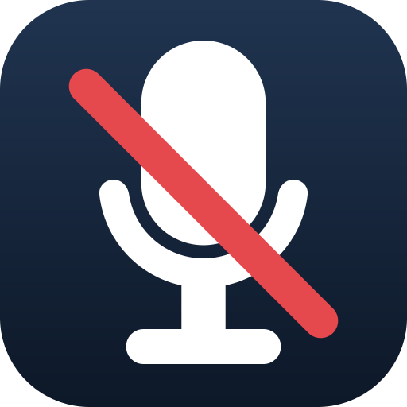

# DeMic：一键静音麦克风

DeMic 是一个常驻 Windows 系统托盘的小工具，提供多种快捷切换麦克风静音状态的功能。

## 功能特性

- **单击静音**：单击托盘图标切换所有麦克风的静音状态。
- **全局热键**：使用自定义热键切换静音状态。`热键+` 插件另外提供开、关、PTT（按下说话）、PTM（按下静音）等热键类型。
- **命令行控制**：通过命令行参数控制麦克风，适合做成快捷方式或在脚本中调用。
- **插件机制**：把 `*.plugin` 放进程序目录下的 `plugin\` 即可扩展更多功能。插件 SDK 见 [sdk/DemicPlugin.h](sdk/DemicPlugin.h)。内置插件：
  - **麦克风看板**：桌面悬浮窗口，显示麦克风状态；
  - **麦克风配置**：把一套配置作用到全部、默认或指定的麦克风；
  - **热键+**：更丰富的热键模式；
  - **Web 远程控制**：通过手机等设备的浏览器访问即可控制电脑的麦克风状态。

## 指南

- [CLI 使用指南](cli.md)
- [配置文件使用指南](config.md)

## 下载与使用

从 [Releases](https://github.com/mkch/DeMic/releases/latest) 下载 `DeMic-x64.zip`，解压后运行 `DeMic-x64.exe`。

- 单击托盘图标：切换静音状态；
- 右键单击托盘图标：使用更多功能。

## 构建

使用 Visual Studio 2022 及以上版本打开 [DeMic.sln](DeMic.sln)，编译即可。

WebRemote 插件额外依赖 `Boost 1.90` 与 `OpenSSL`。

## 许可

[MIT License](LICENSE)
